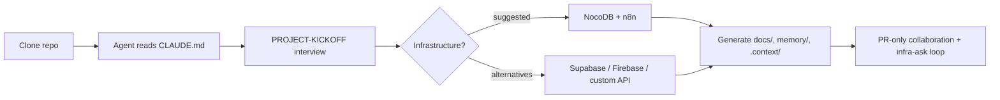

# Agentic Dev Bootstrap — Android

Clone this repo, point your AI agent at it, and it interviews you — including
what infrastructure you'll build on (NocoDB + n8n suggested) — then
bootstraps a **durable** Android project: structure, docs, memory, skills,
and collaboration guardrails.

This gives you everything you need to create a durable development project for Android that lets you:

1. **Context** — set up to maximise context window by tiering directories: the agent only reads what it needs for the task instead of ingesting the entire repo every time. Includes a built-in cost optimiser so cheap agents do simple tasks and leave the complex work for the more expensive agents.
2. **Memory** — durable agent memory: intent, facts, and decisions live in `memory/` and are reinjected after every compaction, session switch, or model change. Project memory is maintained via the repo, so multiple collaborators don't lose track of decisions and to-do items.
3. **Structure** — builds out a structure that keeps architecture, design, decisions and reference information so it can be used throughout the project life. The kickoff interview turns your idea into architecture docs in the first session; multiple people can make decisions on things and the repo remembers them.
4. **Infrastructure** — choose your own infrastructure: NocoDB + n8n suggested; adapts to Supabase/Firebase/custom API. Agents without infra access record asks instead of blocking or leaking credentials.
5. **Multi harness** — run in two harnesses at once: identical skills in Cursor and Claude Code, mirrored by one sync script.
6. **Guardrails** — collaborate safely by default: PR-only rules + pre-push guard for collaborators, owner keeps full control, no credentials in the repo.
7. **M3 standard** — the included skill builds to the M3 standard.

## How it works



## Quickstart

```powershell
git clone https://github.com/clintonherring/agentic-dev-bootstrap-android
cd agentic-dev-bootstrap-android
```

Open the folder in Cursor or Claude Code and paste:

```text
Read CLAUDE.md and follow it. Run tasks/PROJECT-KICKOFF.md with me.
```

The agent interviews you one section at a time, then generates `docs/`,
seeds `memory/`, updates `.context/`, and rewrites `CLAUDE.md` for your
project. See `docs/example/` for what a completed kickoff produces.

## What's in the box

| Path | Purpose |
|------|---------|
| `CLAUDE.md` / `AGENTS.md` | Agent bootstrap: session protocol, kickoff protocol, skills, memory, collaboration rules |
| `tasks/PROJECT-KICKOFF.md` | The interview the agent walks you through |
| `tasks/ONBOARDING-COLLABORATOR.md` | Living checklist for bringing a collaborator in PR-only mode |
| `docs/` | Fill-in templates (app flow, component-process map, DB structure, backend flow mapping) + references + worked example |
| `.cursor/skills/` + `.claude/skills/` | 6 in-repo skills, auto-discovered by both harnesses, mirrored by `scripts/sync-skills.*` |
| `memory/` | NOW / facts / decisions — durable project memory in plain markdown |
| `.context/` | Tiered project index the agent reads before touching source |
| `scripts/git-hooks/pre-push` | Push guard blocking collaborator pushes to `main` |

## Requirements

- git
- An agent harness: Cursor and/or Claude Code
- `python3` on PATH for the Cursor memory hooks (optional — hooks fail open)

## License

MIT — see [LICENSE](LICENSE).
