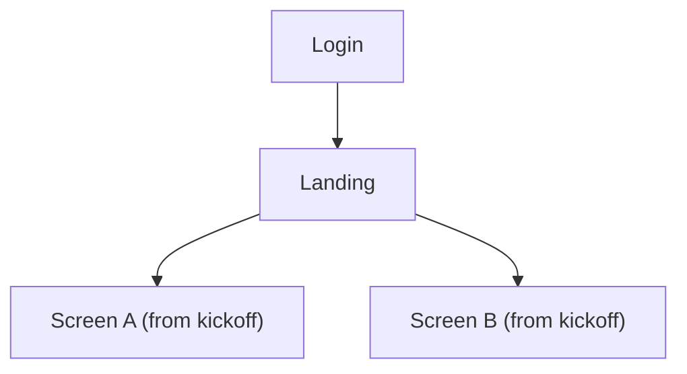

# App flow

> TEMPLATE — filled by the agent during `tasks/PROJECT-KICKOFF.md`.
> See `docs/example/` for what a completed version looks like.

## Screen flow

<!-- Mermaid flowchart of screens: entry point → primary screens → secondary
     screens. Mark unresolved questions as gaps. -->

## Feature map

| Screen | Purpose | Widgets / components | Priority |
|--------|---------|----------------------|----------|
| Login | Entry (dummy auth OK for demos) | — | Must |
| Landing | Home / dashboard | TBD at kickoff | Must |
| — | — | — | — |

## Open questions

<!-- Gaps discovered while mapping. Each gets resolved in tasks/ or via PR. -->

- (none yet — kickoff pending)
