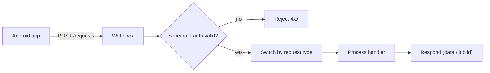

# Backend flow mapping

> TEMPLATE — filled by the agent during `tasks/PROJECT-KICKOFF.md`.
> Default target: n8n workflows exposing webhook APIs. Adapt if the project
> picks another backend.
> See `docs/example/` for a completed version.

## Ingress pattern (suggested)

A single ingress keeps the app simple and the backend swappable:

## Process lanes

| Request type | Workflow | Steps | External calls | Responds |
|--------------|----------|-------|----------------|----------|
| — | — | — | — | — |

## Workflow split

<!-- How workflows are organised: one per domain? one per request type?
     Naming convention. -->

- (decided at kickoff)
