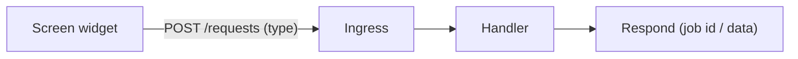

# Component → process map

> TEMPLATE — filled by the agent during `tasks/PROJECT-KICKOFF.md`.
> Maps every screen component/widget to the backend request it makes.
> See `docs/example/` for a completed version.

## Request types

| Component (screen) | Request type | Payload (key fields) | Backend flow | Priority |
|--------------------|--------------|----------------------|--------------|----------|
| — | `example.get` | — | TBD | — |

## Conventions

<!-- Agreed patterns, e.g.: single ingress endpoint, request `type` field,
     job-ID responses for long-running work, staleness rules for widgets. -->

- (decided at kickoff — see `docs/backend-flow-mapping.md` for the ingress pattern)

## Mermaid

