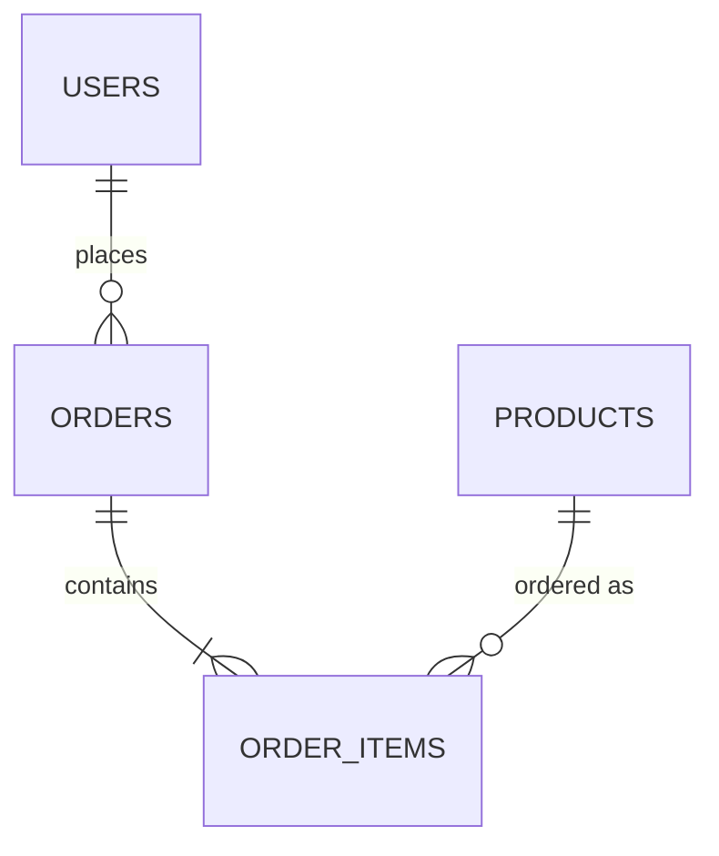

# Database structure

> TEMPLATE — filled by the agent during `tasks/PROJECT-KICKOFF.md`.
> Default target: NocoDB. Adapt if the project picks another database.
> See `docs/example/` for a completed version.

## Tables (demo scope)

| Table | Key fields | Notes |
|-------|-----------|-------|
| users | id, name, role | dummy auth OK for demos |
| — | — | — |

## Tables (later)

<!-- Real-auth users, audit, integrations — anything deferred past demo. -->

- (decided at kickoff)

## Entity relationship

## Conventions

- Demo data paths first; production hardening later.
- IDs, ownership, and created/updated timestamps on every table.
