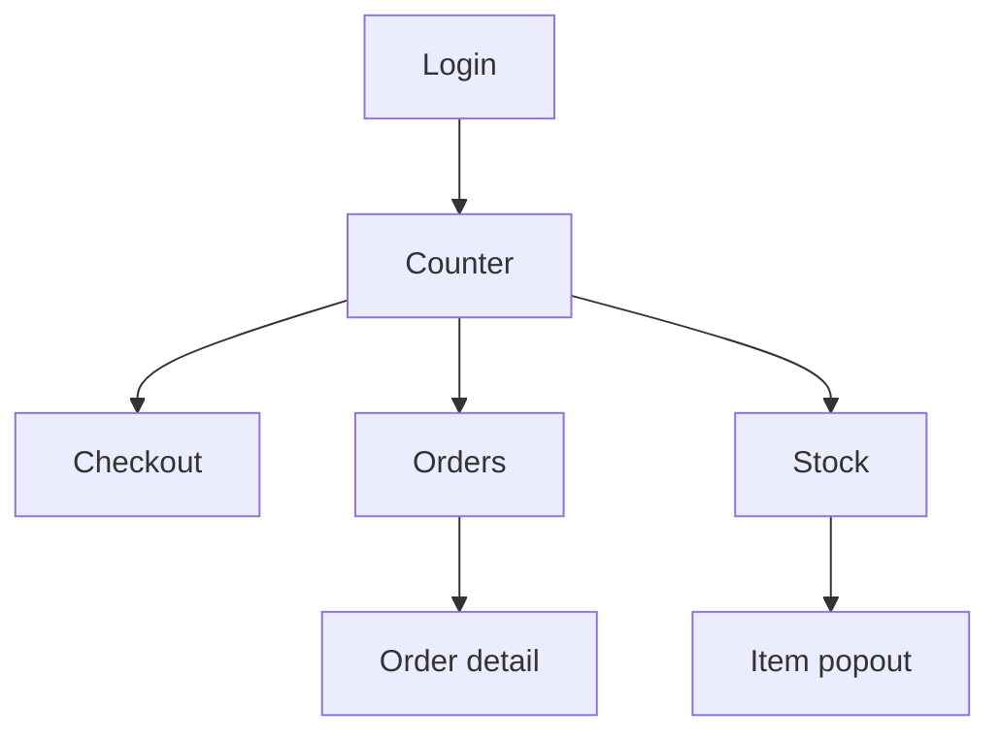
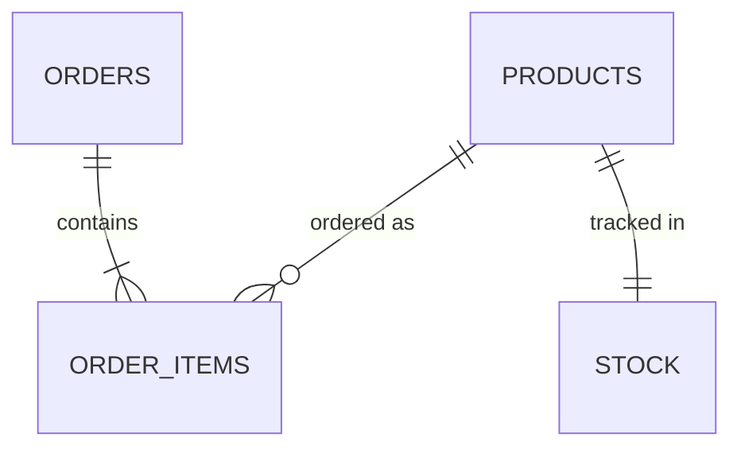

# Worked example: "Bean Counter" (fictional coffee-shop POS)

This is what `docs/` looks like **after** a completed kickoff interview. Your
project's versions live one level up; this one is illustrative and fictional.

## Interview answers (abridged)

- Roles: shop owner + barista
- Screens: Login, Counter, Orders, Stock
- Infra: NocoDB + n8n (suggested default, accepted)
- Device: landscape tablet on the counter; portrait acceptable
- Brand: later

## docs/app-flow.md (excerpt)

| Screen | Purpose | Widgets | Priority |
|--------|---------|---------|----------|
| Counter | New sale | product grid, cart, total, pay button | Must |
| Orders | Today's orders | orders list, status chips | Must |
| Stock | Inventory glance | stock grid, low-stock badge | Should |

## docs/component-process-map.md (excerpt)

| Component | Request type | Backend flow | Priority |
|-----------|--------------|--------------|----------|
| Pay button | `payment.submit` | payments workflow | Must |
| Orders list | `orders.today` | orders workflow | Must |
| Stock grid | `stock.search` | inventory workflow | Should |
| Low-stock badge | `stock.low` | inventory workflow | Could |

## docs/db-structure.md (excerpt)

Tables: `products`, `orders`, `order_items`, `stock`

## docs/backend-flow-mapping.md (excerpt)

Single ingress `POST /requests` → validate → switch by `type` → handler →
respond. Lanes: `payment.submit` (payments workflow: validate cart → record
order → dummy payment OK), `orders.today`, `stock.search`, `stock.low`.
